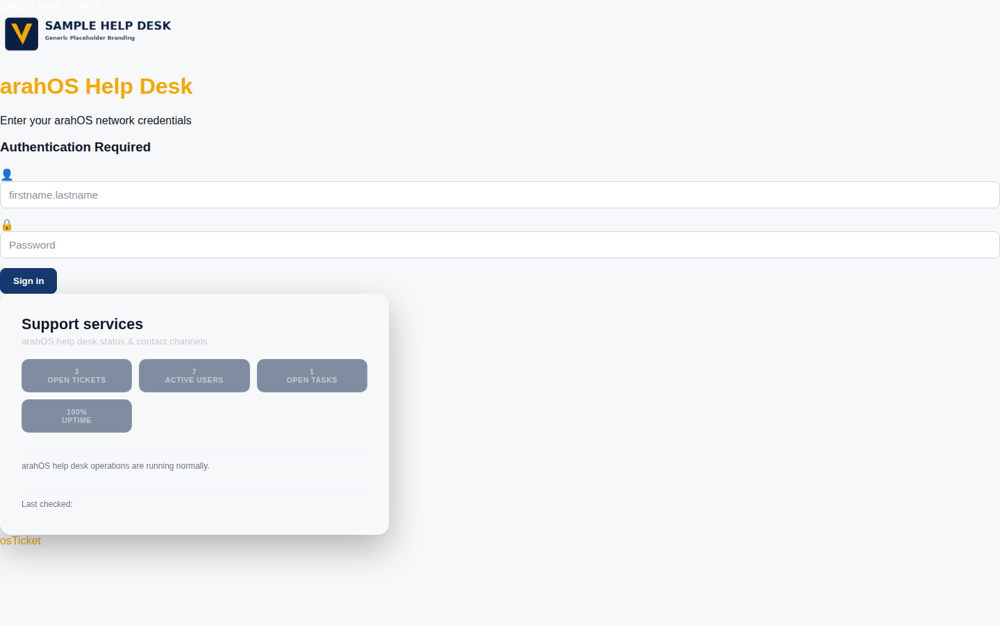

<div align="center">


# ArahOStheme

Lightweight issue tracking and project management — tickets, boards, milestones, and team collaboration with Docker deployment.

[](https://github.com/OneByJorah/TicketForge/releases)
[](https://www.npmjs.com/package/ticketforge)
[](https://www.docker.com/)
[](https://opensource.org/licenses/MIT)

</div>



## What This Is

Lightweight issue tracking and project management — tickets, boards, milestones, and team collaboration with Docker deployment.

## Quick Start

### npm

```bash
npm install ticketforge
```

### Docker

```bash
git clone https://github.com/OneByJorah/TicketForge.git
cd TicketForge
docker compose up -d
```

### From Source

```bash
git clone https://github.com/OneByJorah/TicketForge.git
cd TicketForge
npm install
npm run dev
```

## Features

- **Self-hosted** — run on your own hardware
- **Docker Compose** — full stack with one command
- **npm package** — install via npm
- **Dark theme** — operational UI

- **Issue tracking** — create, assign, and track issues
- **Kanban boards** — visual workflow management
- **Milestones** — group issues by release or goal
- **Team collaboration** — comments, assignments, notifications
- **Docker Compose deployment** — self-hosted instance
- **Dark theme** — developer-friendly, minimal UI

## Package Badges

[](https://github.com/OneByJorah/TicketForge/releases)
[](https://www.npmjs.com/package/ticketforge)
[](https://www.docker.com/)
[](https://opensource.org/licenses/MIT)

## Contributing

[Open an issue](https://github.com/OneByJorah/TicketForge/issues) to report a bug or request a feature.

## License

MIT — see [LICENSE](LICENSE).
