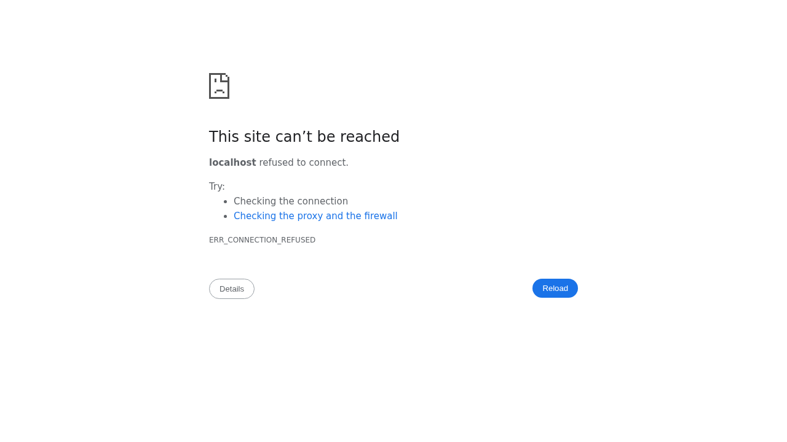

# ArahOStheme

> A premium merged osTicket theme and plugin — full-width branded backend, split-screen agent login, and a PWA-ready client portal for osTicket 1.18.x.

[](https://github.com/OneByJorah/TicketForge)
[](https://github.com/OneByJorah/TicketForge)
[](https://github.com/OneByJorah/TicketForge/stargazers)
[](https://github.com/OneByJorah/TicketForge/commits)
[](https://github.com/OneByJorah/TicketForge/actions)



## What This Is

ArahOStheme is the unified successor to [arahOS-theme](https://github.com/OneByJorah/arahOS-theme) and [oshelpdesk](https://github.com/OneByJorah/oshelpdesk): the ArahOS navy-and-gold design language plus the osHelpdesk deployment tooling in one codebase — a full-width staff backend, split-screen agent login, polished client portal, and PWA front end for osTicket **1.18.x**. Two install paths are supported: a plugin-plus-template installer, or a marker-guarded idempotent injection script, so you can pick whichever fits your deployment.

## Quick Start

```bash
git clone https://github.com/OneByJorah/TicketForge.git && cd ArahOStheme
sudo ./install.sh /var/www/osticket/upload   # plugin + template assets
```

Then enable **ArahOS Help Desk Theme** in **Admin Panel → Manage → Plugins**, and optionally seed the knowledge base with `db/kb-seed.sql`.

## Features

- **Client portal** — full-width card layout with a persisted light/dark toggle.
- **Split-screen agent login** — brand panel on the left, credentials form on the right.
- **Single login redirect** — one sign-in covers both admin and client areas.
- **Seeded knowledge base** — `db/kb-seed.sql` gives you a populated FAQ on first run.
- **PWA-ready** — `manifest.webmanifest`, service worker, install prompt, and an offline page.
- **Responsive** — breakpoints at 380 / 480 / 600 / 768 / 900 / 1100 px.
- **Idempotent deploy** — `deploy.sh` injects theme blocks between `HELPDESK-THEME-INJECT` markers and writes `.bak` backups before touching any osTicket file.

## Architecture

osTicket bootstraps plugins before the global `$ost` header API exists, so the theme CSS is emitted by the overridden header templates (which render after `$ost`/`$cfg` are live) rather than the plugin's bootstrap. The plugin class exists so the theme is discoverable and enable-able in the admin panel and so `getInstallPath()` resolves; `deploy.sh` instead injects references via marker-guarded edits to `include/client/header.inc.php` and `include/staff/header.inc.php`.

```
ArahOStheme/
├── plugin/            # osTicket plugin (manifest, class, client/staff CSS)
├── css/arahOS/        # tokens + agent-login, client-portal, staff-panel styles
├── js/arahOS/         # landing, PWA install, client-portal, staff-panel scripts
├── include/           # client/staff header, footer, and login template overrides
├── theme/             # osHelpdesk-style tokens and assets
├── db/kb-seed.sql     # knowledge-base seed content
├── install.sh         # Option A: plugin + template installer
└── deploy.sh          # Option B: idempotent injector
```

## Stack

CSS3 · Vanilla JavaScript · PHP (osTicket plugin + template overrides) · Bash · MySQL/MariaDB

## Contributing

See [CONTRIBUTING.md](CONTRIBUTING.md) and [CODE_OF_CONDUCT.md](CODE_OF_CONDUCT.md). [Open an issue](https://github.com/OneByJorah/TicketForge/issues) for bugs or ideas.

## License

MIT — see [LICENSE](LICENSE).
