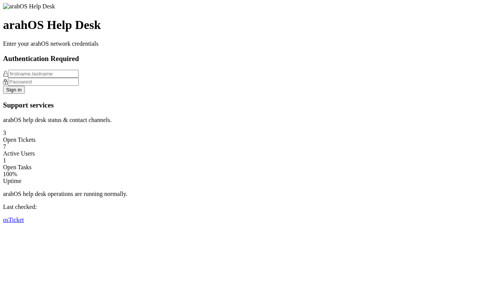
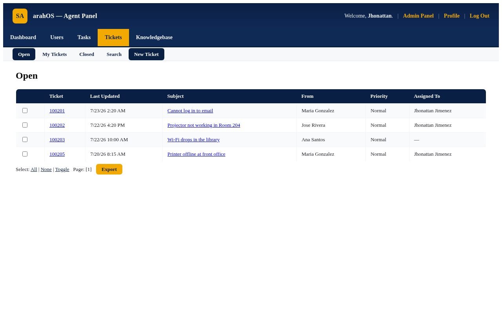
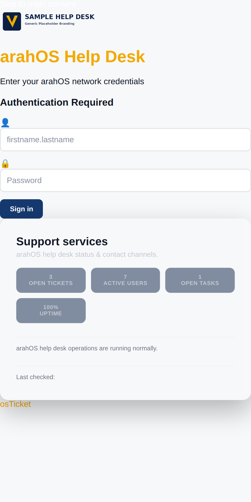

<div align="center">


# ArahOStheme

**The premium merged osTicket helpdesk theme + plugin — a full-width branded backend, split-screen agent login, and a PWA-ready client portal for osTicket 1.18.x.**

<a href="https://github.com/OneByJorah/ArahOStheme/stargazers"></a>
<a href="https://github.com/OneByJorah/ArahOStheme/commits"></a>


</div>


## What This Is

ArahOStheme is the unified, maintained successor to [arahOS-theme](https://github.com/OneByJorah/arahOS-theme) and [oshelpdesk](https://github.com/OneByJorah/oshelpdesk). It combines the ArahOS navy-and-gold design language with the osHelpdesk deployment tooling into a single codebase: a full-width modern backend, a split-screen agent login, a polished client portal, single-login convenience, and a PWA-ready front end for osTicket **1.18.x**.

Two install paths are supported — a plugin-plus-template installer and an osHelpdesk-style injection deploy script — so you can pick whichever fits your deployment.

## Quick Start

```bash
git clone https://github.com/OneByJorah/ArahOStheme.git && cd ArahOStheme
sudo ./install.sh /var/www/osticket/upload   # Option A: plugin + template assets
```

Then enable **ArahOS Help Desk Theme** in **Admin Panel → Manage → Plugins**, and optionally seed the knowledge base with `db/kb-seed.sql`.

## Features

- **Client portal** — full-width card layout with a persisted light/dark toggle.
- **Split-screen agent login** — helpdesk brand on the left, credentials form on the right.
- **Single login redirect** — one sign-in covers both the admin and client areas.
- **Knowledge base / FAQ** — pre-seeded `db/kb-seed.sql` for a quick start.
- **Responsive** — breakpoints at 380 / 480 / 600 / 768 / 900 / 1100 px.
- **PWA-ready** — `manifest.webmanifest`, `sw.js`, install prompt (`js/arahOS/arahOS-pwa-install.js`), and an offline page.
- **Full-width staff backend** — refined navy-and-gold palette across the agent panel.
- **Two install paths** — plugin + template installer, or the idempotent osHelpdesk injection script.

## Architecture

```
ArahOStheme/
├── plugin/                  # osTicket plugin (manifest, class, client/staff CSS)
├── css/arahOS/              # ArahOS tokens + agent-login, client-portal, staff-panel
├── js/arahOS/               # landing, PWA install, client-portal, staff-panel
├── include/
│   ├── client/              # header/footer/login/accesslink overrides
│   └── staff/              # header/footer/login template overrides
├── theme/                   # osHelpdesk-style theme (tokens + client/staff assets)
│   ├── css/ · js/ · assets/
├── db/kb-seed.sql           # knowledge-base seed content
├── showcase/                # agent-login, staff-dashboard, responsive demos
├── preview/                 # index.html, staff-preview.html
├── install/                 # CLIENT_INJECTION.md, STAFF_INJECTION.md
├── index.php                # branded landing page
├── manifest.webmanifest, sw.js, offline.html, .htaccess
├── install.sh               # Option A installer
└── deploy.sh                # Option B idempotent injector
```

### How the styles are delivered

osTicket bootstraps plugins before the global `$ost` header API is available, so the theme CSS is emitted by the overridden header templates (which render after `$ost`/`$cfg` are live). The plugin exists so the theme is discoverable and enable-able in the admin panel and its install path is known.

The `deploy.sh` path injects the theme snippet into `include/client/header.inc.php` and `include/staff/header.inc.php` between `HELPDESK-THEME-INJECT` markers — marker-guarded, with `.bak` backups — and references the theme via `$cfg->style = 'ArahOStheme';` in `include/ost-config.php`.

## Install options

### Option A — Plugin + template assets

```bash
sudo ./install.sh /var/www/osticket/upload
```

Copies `plugin/`, `css/arahOS/`, and `js/arahOS/`, overrides the staff/client header and login templates, installs the root PWA files, then fixes ownership (`www-data:www-data`).

### Option B — osHelpdesk style + deploy script

```bash
cd /path/to/osticket
cp -r theme/* include/          # as documented in theme/assets/LOGO.md
sudo /path/to/ArahOStheme/deploy.sh
```

### Option C — Manual (no script)

1. Copy `plugin/` → `include/plugins/`.
2. Copy `css/arahOS/` → `css/arahOS/` and `js/arahOS/` → `js/arahOS/`.
3. Copy the override templates from `include/` into the matching osTicket paths (see [install/CLIENT_INJECTION.md](install/CLIENT_INJECTION.md) and [install/STAFF_INJECTION.md](install/STAFF_INJECTION.md)).
4. Copy the root PWA files (`manifest.webmanifest`, `sw.js`, `offline.html`, `.htaccess`, `index.php`).

## Design system

| Token | Value |
|---|---|
| Brand navy (ArahOS) | `#0a1f44` |
| Brand gold (ArahOS) | `#f2a900` |
| Navy primary (osHelpdesk) | `#1a237e` |
| Navy secondary (osHelpdesk) | `#283593` |
| Gold primary (osHelpdesk) | `#ffb300` |
| Gold secondary (osHelpdesk) | `#ffc107` |

All tokens are defined in `css/arahOS/arahOS-tokens.css` and `theme/css/helpdesk-tokens.css`.

## Hardening

- `deploy.sh` writes files as `0644` (dirs `0755`) and never overwrites user edits: injected blocks are wrapped in `HELPDESK-THEME-INJECT` markers and a `.bak` is written before any modification.
- `SECURITY.md` describes security reporting; `CODE_OF_CONDUCT.md` sets community expectations.

## Compatibility

| osTicket | Status |
|----------|--------|
| 1.18.x   | Fully supported |
| 1.17.x   | Works, untested |
| 1.16.x   | Not supported |

## Tech Stack

CSS3, vanilla JavaScript, PHP (osTicket plugin + template overrides), Bash (install scripts), MySQL/MariaDB.

## Screenshots

| View | |
|---|---|
|  |  |
|  |  |
|  |  |

Live, interactive demos: `showcase/agent-login.html`, `showcase/staff-dashboard.html`, and `showcase/responsive.html`.

## Contributing

See [CONTRIBUTING.md](CONTRIBUTING.md) and [CODE_OF_CONDUCT.md](CODE_OF_CONDUCT.md). [Open an issue](https://github.com/OneByJorah/ArahOStheme/issues) for bugs or ideas.

## License

MIT — see [LICENSE](LICENSE). © 2026 OneByJorah / JorahOne Networks.

## Acknowledgements

ArahOStheme merges the [arahOS-theme](https://github.com/OneByJorah/arahOS-theme) plugin and the [oshelpdesk](https://github.com/OneByJorah/oshelpdesk) deployment project into a single maintained codebase. Original work by the Virgin Islands Department of Education — Office of Information Technology.

## Connect

- [jorahone.com](https://jorahone.com)
- [GitHub Org](https://github.com/OneByJorah)
- [info@jorahone.com](mailto:info@jorahone.com)
